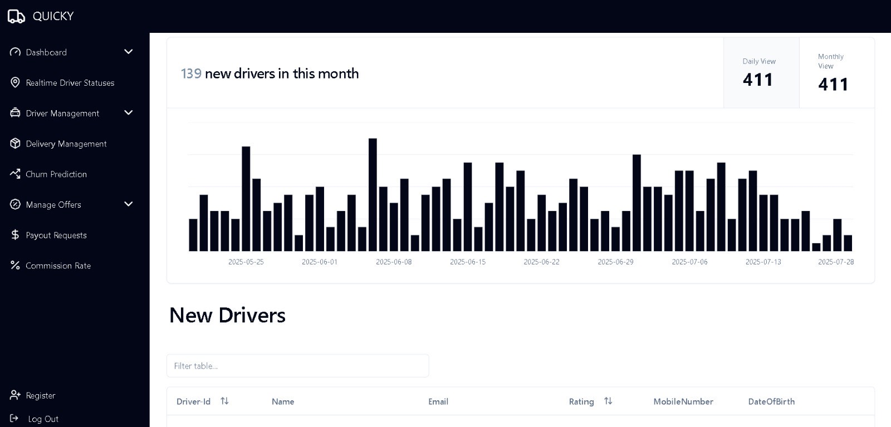
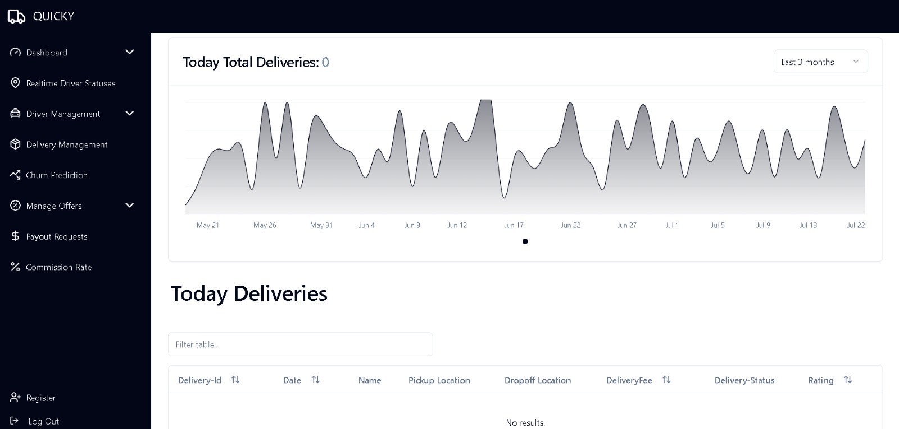
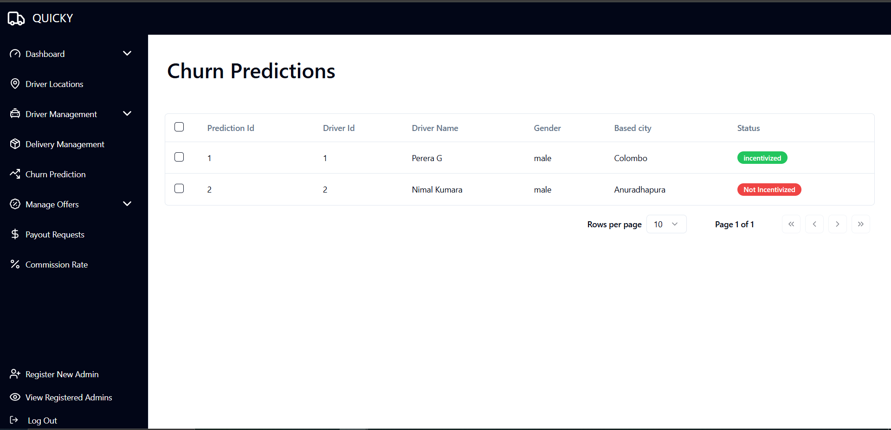
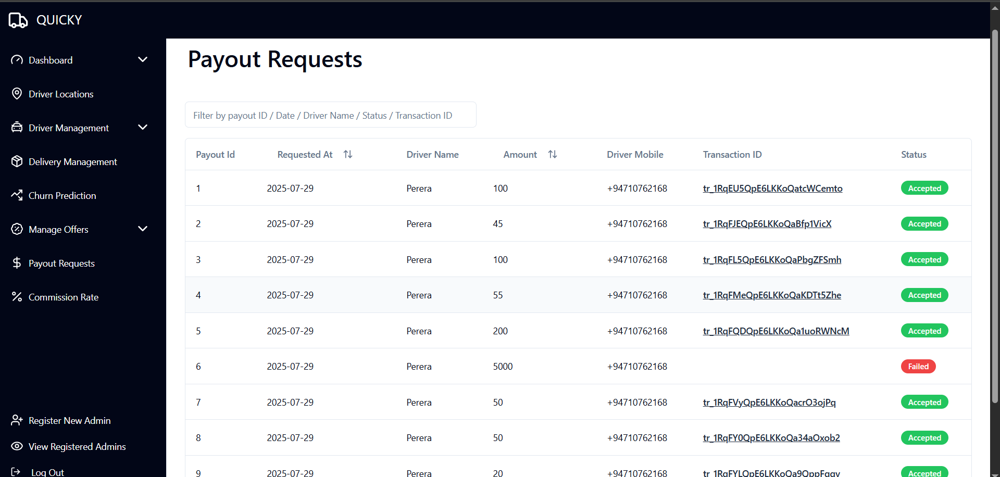
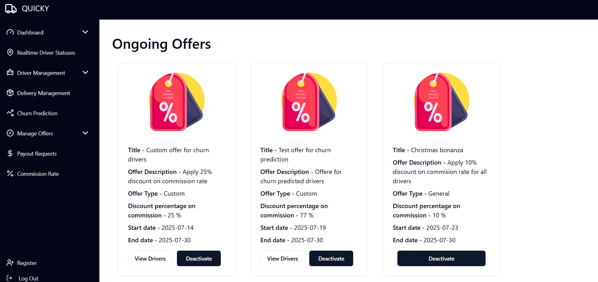
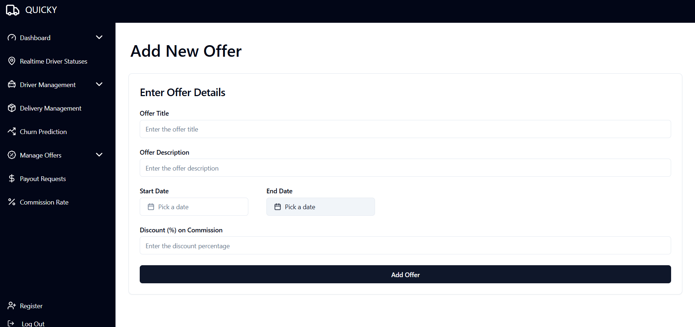
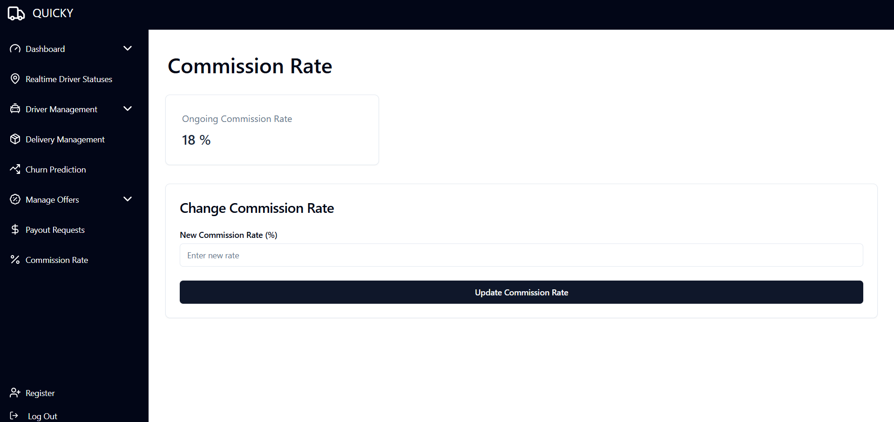

# Quicky Admin Frontend
This repository include the project files related to admin frontend of Quicky delivery platform.

## Getting Started
To get started with the project, follow these steps:

1. Clone the repository:
    ```bash
    git clone https://github.com/HashiruG/Quicky_Frontend.git
    ```
2. Navigate to the project directory:
    ```bash
    cd Quicky_Frontend
    ```
3. Install the dependencies:
    ```bash
    pnpm install
    ```
4. To start the server:
    ```bash
    pnpm dev
    ```

## Other Repositories associated with this project
1. Quicky admin backend : [https://github.com/HashiruG/Quicky_Backend](https://github.com/HashiruG/Quicky_Backend)
2. Quicky admin churn prediction : [https://github.com/HashiruG/Quicky_Admin_Churn_Prediction](https://github.com/HashiruG/Quicky_Admin_Churn_Prediction) 


## Few Screenshots
<p align="center">
  
</p>
<p align="center">
  
</p>
<p align="center">
  
</p>
<p align="center">
  
</p>
<p align="center">
  
</p>
<p align="center">
  
</p>
<p align="center">
  
</p>
<p align="center">
  
</p>

